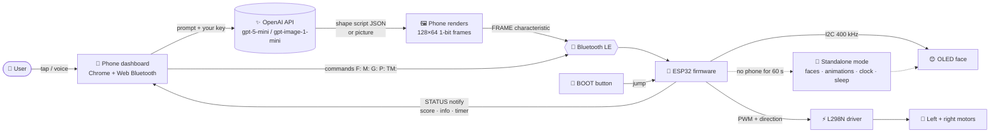
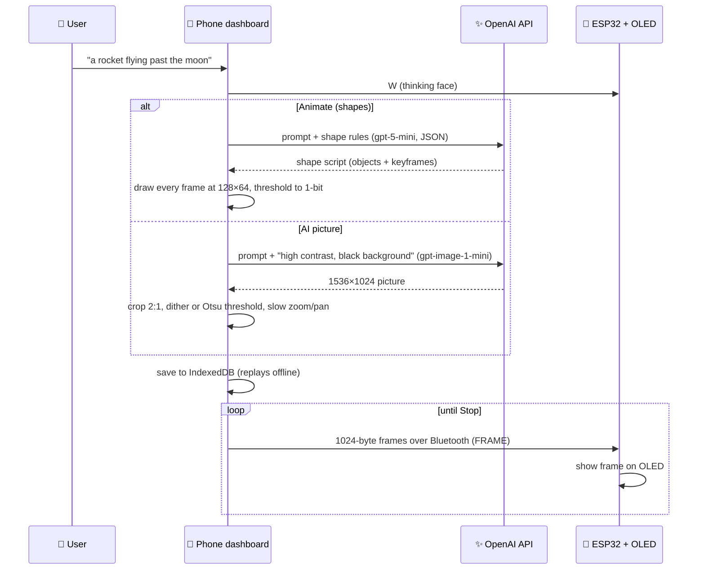

# Robonauts Assistant: AI-Powered Desktop Robot 🤖✨

An **AI-powered** robot by **Robonauts Ltd**, built on an **ESP32** with a **0.96" OLED face** and two drive wheels.
It runs on its own from a power bank. A phone web dashboard controls it over Bluetooth, with no app install needed.
**OpenAI** turns a sentence into a brand-new animation on the robot's face.

**Live dashboard:** https://mridulh404-art.github.io/robonauts-assistant/
(Open it in **Chrome on Android**, because Web Bluetooth is needed.)

<p align="center">
  
  
</p>
<p align="center"><i>Left: a rocket animation on the OLED face. Right: one of its 9 expressions.</i></p>

---

## Features

| Feature | How it works |
|---|---|
| 😊 **Animated face** | 9 expressions with blinking eyes and a mouth: neutral, happy, sad, angry, love, sleepy, surprised, wink, think |
| 🤖 **Standalone mode** | With no phone for 60 s it cycles through faces, stored animations and the clock by itself. It sleeps from 22:00 to 07:00 |
| 🎮 **Robo Runner game** | Plays on the OLED. Jump with the **JUMP** button on the phone or the **BOOT** button on the ESP32. The high score is saved |
| 🎞 **23 stored animations** | Saved in the ESP32's flash and played straight from the robot |
| 🕒 **Clock and timer** | Time from the phone or from Wi-Fi (NTP). Countdown timer with an alert |
| 💬 **Messages** | Show any text on the robot's screen |
| ✨ **AI-powered animations** (OpenAI) | *Animate (shapes)*: the AI writes a moving-shape script. *AI picture*: an AI image turned into black and white with a slow zoom. Both are saved on the phone for offline replay |
| 🧠 **Ask Robonauts** | Ask a question. The robot thinks, then answers with a face and a short text (Claude or OpenAI key) |
| 🎤 **Voice commands** | "happy", "show clock", "timer 5 minutes", "play game", "animate a rocket", and more |
| 🛞 **Wheels** | Two gear motors through an L298N driver. The wiring is ready, and phone remote-control driving is in progress |
| 🎵 **Songs** | Play an mp3 on the phone with a synced OLED animation (`.rbf.gz` files made in Robonauts OLED Studio) |

The dashboard has **controls only**. Everything is shown on the robot's OLED, not on the phone.

<p align="center"></p>
<p align="center"><i>The phone dashboard: controls only. The output appears on the robot.</i></p>

---

## How it works (system workflow)



### AI animation pipeline



1. **You describe it** in words or by voice.
2. **The AI creates it:** either a small JSON "shape script" (circles, stars, hearts, text, with keyframes) or a picture.
3. **The phone converts it** into 128×64 black-and-white frames in the SSD1306 page format. The phone never shows it; it only goes to the robot.
4. **It streams over Bluetooth** to the ESP32, which draws it on the OLED.
5. **It's saved on the phone**, so it replays at a showcase with no internet.


---

## Hardware

| Part | Notes |
|---|---|
| ESP32 DevKit V1 (ESP32-D0WD) | Any ESP32 with BLE works |
| 0.96" SSD1306 OLED, I2C, 128×64 | Address 0x3C (0x3D is also detected automatically) |
| L298N motor driver plus 2 TT gear motors and wheels | Remote-control drive |
| USB cable plus power bank | The ESP32 and OLED draw about 0.1–0.25 A |
| 2× 18650 battery (7.4 V) | Recommended for the motors. The L298N drops about 2 V |
| 3D-printed pink robot head | STL/STEP files in the project's `chassis` folder |

### Circuit diagram

<p align="center"></p>

### Wiring: OLED

| OLED pin | ESP32 pin |
|---|---|
| GND | GND |
| VCC | **3V3** |
| SCL | **D22** |
| SDA | **D21** |

### Wiring: motors (L298N)

| L298N pin | Connect to | Purpose |
|---|---|---|
| ENA | ESP32 **D25** (remove the jumper cap) | Left motor speed (PWM) |
| IN1 / IN2 | ESP32 **D26** / **D27** | Left motor direction |
| IN3 / IN4 | ESP32 **D32** / **D33** | Right motor direction |
| ENB | ESP32 **D13** (remove the jumper cap) | Right motor speed (PWM) |
| GND | ESP32 GND **and** battery − | Common ground (required) |
| VS (12V) | Battery + (7.4 V) | Motor power |
| OUT1 / OUT2 | Left motor | |
| OUT3 / OUT4 | Right motor | |

These pins avoid the OLED (D21/D22), the BOOT button (GPIO0) and the ESP32's start-up pins (GPIO 2, 12, 15), so the wheels don't twitch at power-on. The ESP32's 3.3 V signals are above the L298's 2.3 V minimum "high" input (ST L298 datasheet).
With no battery, for testing only: ESP32 VIN → L298N VS and 5V, and remove the 5V jumper. Keep the wheels off the ground and use low speed.

> Use good, tight jumper wires. A loose OLED wire can make the ESP32 restart (`POWERON_RESET`) or leave the screen black.

### Buttons

- **EN**: reset. Press it after uploading if the screen stays black.
- **BOOT**: start or jump in Robo Runner. Hold it during `Connecting....` when uploading.

---

## Firmware (ESP32)

The firmware (`RobonautsAssistant.ino` + `anim_data.h`) lives in the project folder and is not in this repository.

1. Install **Arduino IDE 2**, the board package **esp32 by Espressif Systems** (3.3.x), and the library **Adafruit SSD1306** (with Adafruit GFX and BusIO).
2. Board: **ESP32 Dev Module**. Partition Scheme: **Huge APP (3MB No OTA/1MB SPIFFS)**. The firmware is about 2.18 MB because of the stored animations.
3. Upload. Hold **BOOT** while it says `Connecting....`, then press **EN** after the upload.

Upload from PowerShell with the arduino-cli inside Arduino IDE:

```powershell
$CLI = (Get-ChildItem "C:\Program Files\Arduino IDE", "$env:LOCALAPPDATA\Programs\Arduino IDE" -Recurse -Filter arduino-cli.exe -ErrorAction SilentlyContinue | Select-Object -First 1).FullName
$SKETCH = "$env:USERPROFILE\Documents\Arduino\RobonautsAssistant"
& $CLI compile --fqbn "esp32:esp32:esp32:PartitionScheme=huge_app" $SKETCH
& $CLI upload  --fqbn "esp32:esp32:esp32:PartitionScheme=huge_app,UploadSpeed=115200" -p COM3 $SKETCH
```

---

## Monitoring and troubleshooting

Open the serial monitor (115200 baud) to see the robot's health report:

```powershell
& $CLI monitor -p COM3 --config baudrate=115200,dtr=off,rts=off
```

| You see | Meaning |
|---|---|
| `OLED found at 0x3C` | The screen is connected correctly |
| `OLED NOT responding on I2C` | Check the SDA (D21), SCL (D22), VCC (3V3) and GND wires |
| `Robonauts-Bot ready (BLE)` | Bluetooth is on, so the phone can connect |
| `heap free=54000 min=53000` | Free memory, printed every 10 s. It should stay steady |
| repeated `rst:0x1 (POWERON_RESET)` | Power is dropping, usually a loose OLED wire or a weak USB supply |
| `assert failed: host_recv_pkt_cb` | The Bluetooth stack ran out of memory. Update to the latest dashboard |
| upload stuck on `Connecting....` | Hold **BOOT** during the upload, then press **EN** |

## Using the dashboard

1. Power the robot. The face appears.
2. Open the dashboard link in **Chrome (Android)** and tap **Connect**, then choose **Robonauts-Bot**.
3. On connect, the phone sends the time and asks the robot what it supports.
4. Optional: in **Robot settings**, save a **2.4 GHz phone hotspot** so the robot gets the time from the internet without the phone.
5. Optional: add an **OpenAI key** (AI animations) or a **Claude key** (Ask Robonauts) in the settings sections.

---

## Bluetooth protocol (for developers)

Nordic-UART-style service `6e400001-b5a3-f393-e0a9-e50e24dcca9e`

| Characteristic | UUID ending | Use |
|---|---|---|
| CMD | `...0002` | write text commands |
| STATUS | `...0003` | notify: `TIMER_DONE`, `INFO:...`, `GAME:<score>,<best>`, `GAME_OVER:<score>,<best>` |
| FRAME | `...0004` | 2-byte big-endian offset + data, 1024-byte frame in SSD1306 page format |

| Command | Action |
|---|---|
| `F:<face>` | Show a face |
| `K` / `TM:<secs>` | Clock / countdown timer |
| `M:<text>` | Show a message |
| `P:<n>` | Play stored animation n |
| `G:start` / `G:jump` / `G:stop` | Robo Runner |
| `T:<secs>` / `TZ:<secs>` | Set local time / time zone offset |
| `WIFI:<ssid>\t<pass>` | Save Wi-Fi for the clock |
| `SLEEP:h,w` / `AUTO:1\|0` / `INFO` | Sleep hours / standalone mode / status |

---

## Privacy and security

- **No API keys or passwords are in this repository.** Keys you enter are stored only in your phone's browser (localStorage), and Wi-Fi details only in the ESP32.
- AI requests go straight from your phone to OpenAI or Anthropic using your own key.
- Never commit a key to this repo. If one leaks, revoke it and create a new one.
- The robot's Bluetooth has no PIN. While a phone is connected, no one else can connect.

---

## Files in this repo

| File | What it is |
|---|---|
| `index.html` | The phone dashboard (one self-contained page) |
| `animations.rbp.gz` | Animation pack used by the dashboard |
| `README.md` | This file |
| `images/` | Photos, the dashboard screenshot and the circuit diagram |

---

Made by **Mridul Hasan Sagor**, **Robonauts Ltd**.
